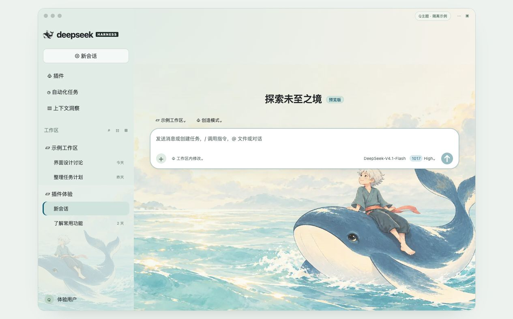
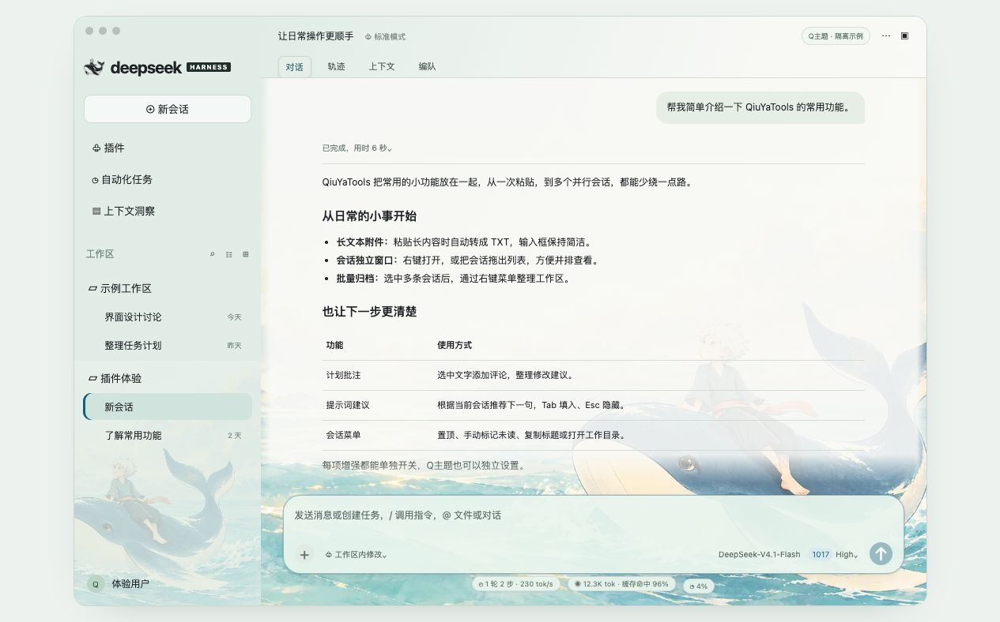
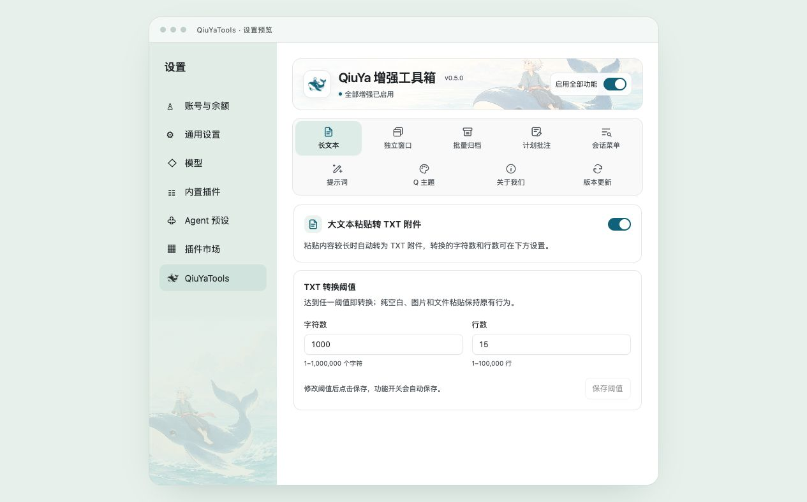
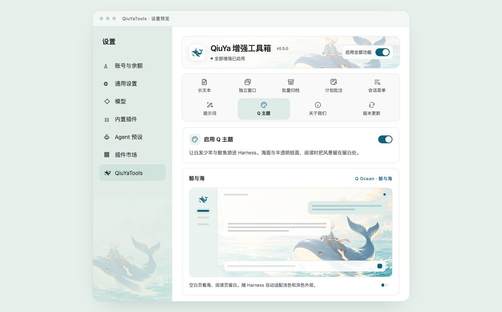
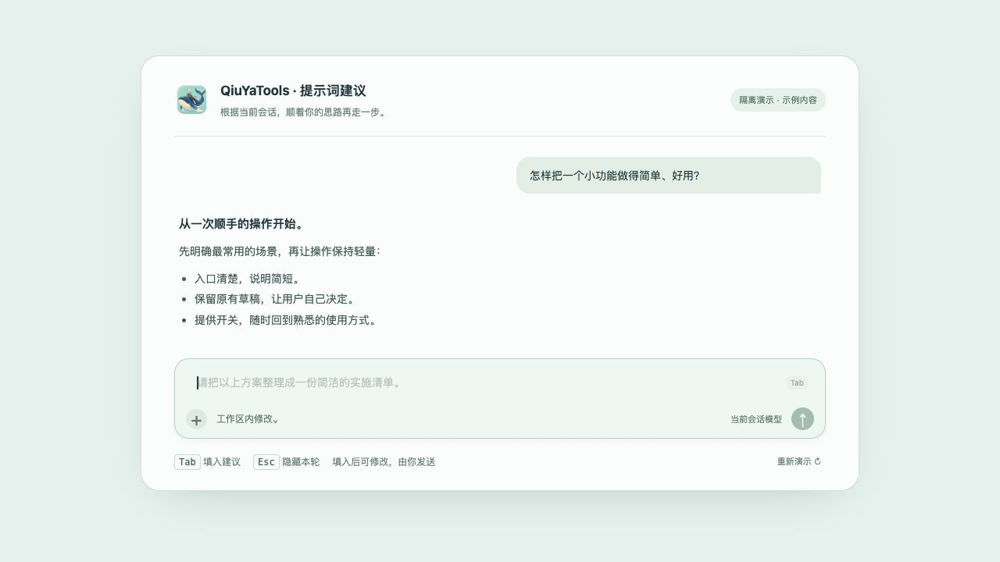

# QiuYa 增强工具箱

给 DeepSeek Harness 加一点顺手的小功能。

## 安装

1. 打开 Harness 的 **插件 → 添加插件**。
2. 粘贴下面的完整链接并安装：

   ```text
   https://github.com/z1223473749/dsh-QiuYaTools/releases/latest/download/dsh-qiuya-tools.tgz
   ```

3. 点击 **立即启用**，进入 **设置 → QiuYaTools**。

左下角账号菜单也有 QiuYaTools 入口。

## 功能

| 功能 | 怎么用 |
| --- | --- |
| 长文本附件 | 粘贴长文本自动转为 TXT，默认 1000 个字符或 15 行，阈值可调。 |
| 会话独立窗口 | 右键打开，或把会话拖出列表；再次打开同一会话会唤起已有窗口。 |
| 批量归档 | Shift 连选、⌘ / Ctrl 多选后右键归档，也可归档工作区全部会话。 |
| 计划批注 | 选中计划文字添加评论，提交修改建议，保留输入框原有草稿。 |
| 会话菜单 | 右键置顶、手动标记已读 / 未读、复制标题 / 会话 ID / 工作目录路径、打开目录；工作区也可移到顶部。 |
| 提示词建议 | 回复结束后，点击空输入框，根据当前会话推荐下一句。按 **Tab** 填入、**Esc** 隐藏，可修改后手动发送。 |
| Q主题「鲸与海」 | 手绘鲸鱼与白发少年背景，搭配柔和的半透明界面，支持浅色、深色外观。 |

六项增强默认开启，可单独开关，也可一键全选。Q主题默认关闭，独立设置。功能入口分为两排，无需横向滚动。

提示词建议使用当前会话所选模型，会产生少量额外模型用量。

## 界面预览

以下为隔离示例预览，主题使用插件实际样式；不含真实会话、项目或账号数据。

**Q主题 · 新会话**



**Q主题 · 会话阅读**



**功能设置**



**Q主题设置**



**提示词建议**

聚焦空输入框显示建议，按 Tab 填入。以下用示例回复演示交互，不调用真实模型。



## 更新与兼容

在 **QiuYaTools → 版本更新 → 检查更新** 中升级，完成后完全退出并重新打开 Harness，原有设置保留。

当前适配官方 macOS Harness **0.2.1-rc.2**。独立窗口需要 **macOS 13+**，安装包包含 Apple Silicon 和 Intel 组件。

[发布版本](https://github.com/z1223473749/dsh-QiuYaTools/releases) · [问题反馈](https://github.com/z1223473749/dsh-QiuYaTools/issues) · [使用与开发](docs/development.md) · [www.qiuya.cc](https://www.qiuya.cc)
