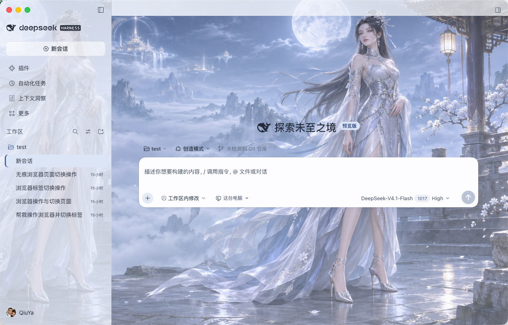
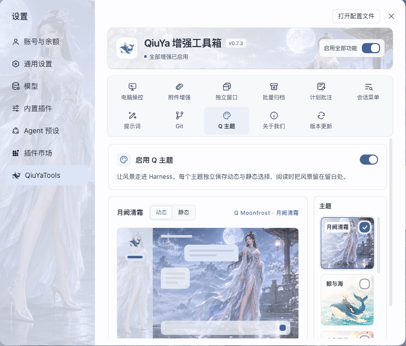
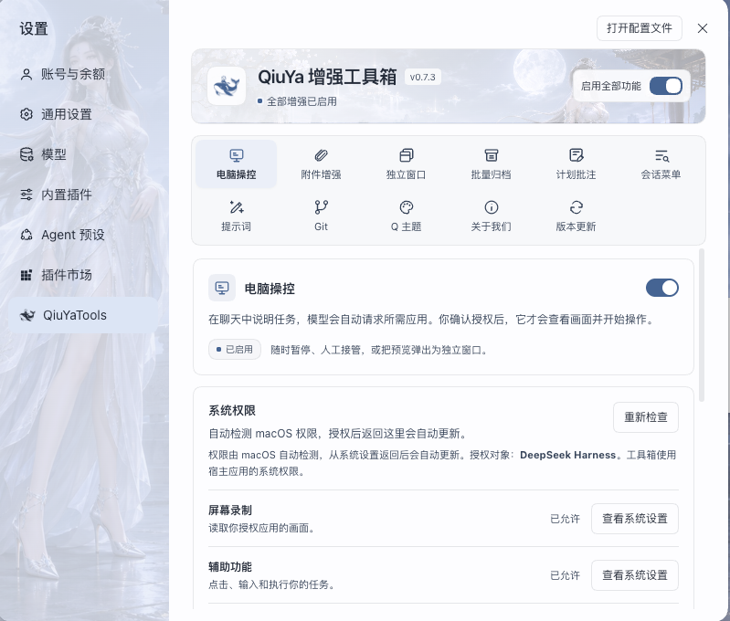
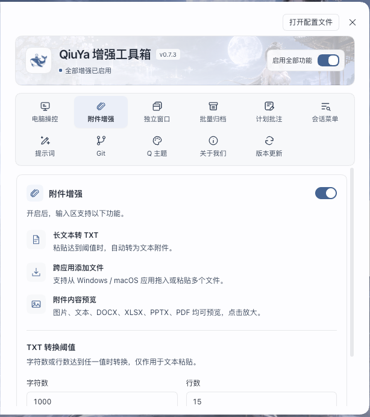
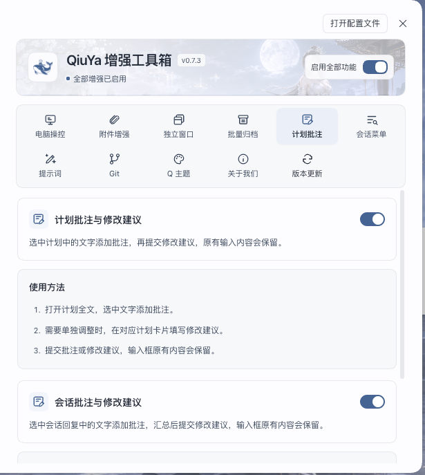
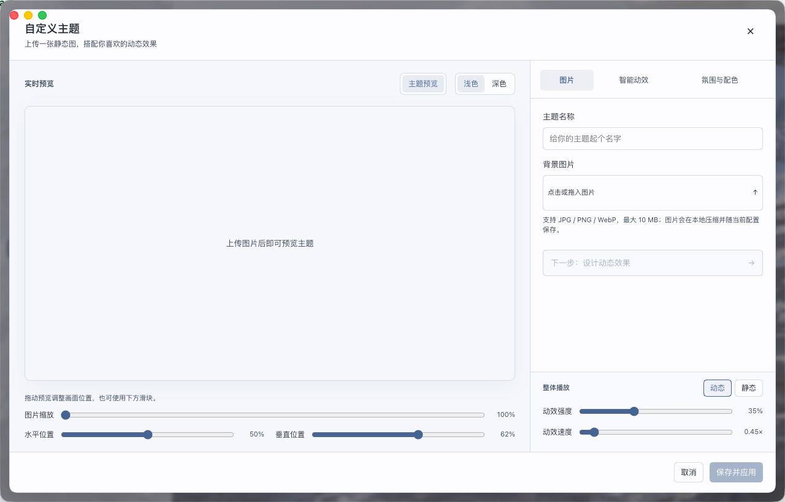

# QiuYa 增强工具箱

AI 智能动效主题、电脑操控、独立窗口、附件预览、Git 管理、会话分窗与批注、跨应用文件拖拽、AI 提示词。

在 Harness 的「插件 → 添加插件」中输入 `https://github.com/z1223473749/dsh-QiuYaTools` 安装。

[源码与使用说明](https://github.com/z1223473749/dsh-QiuYaTools) · [下载完整安装包](https://github.com/z1223473749/dsh-QiuYaTools/releases/latest)

## 界面预览

**主题主页**

**Q 主题设置**

**电脑操控**

**附件增强**

**计划与会话批注**

**自定义主题**

